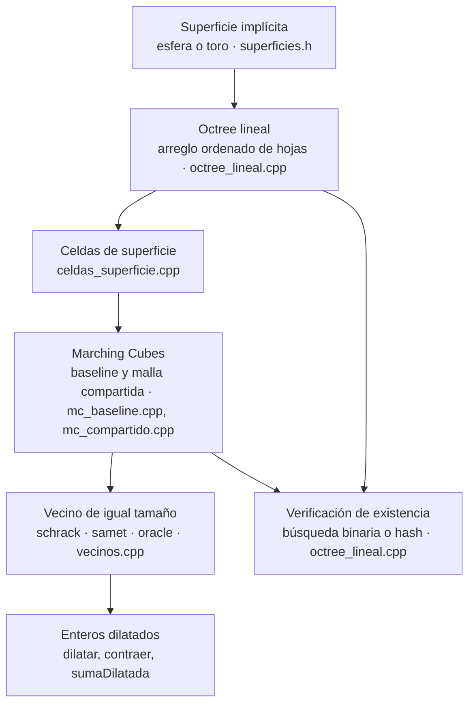
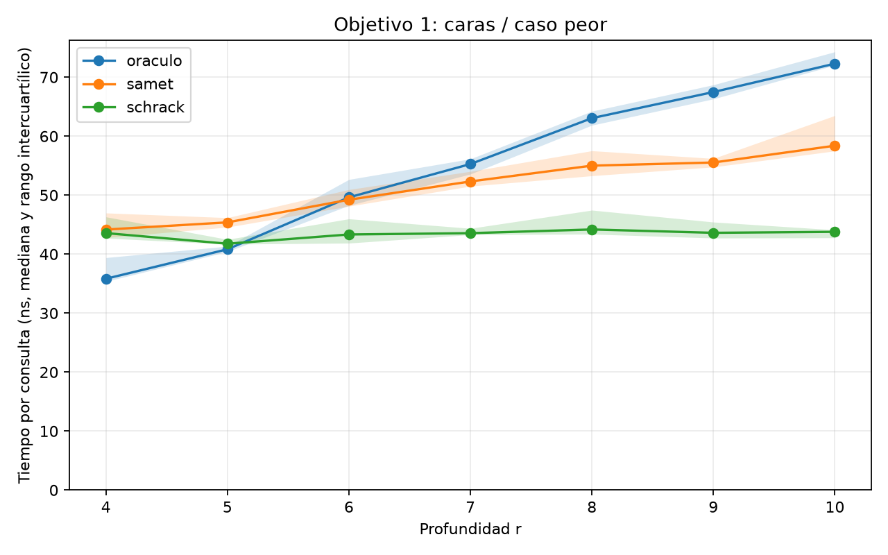
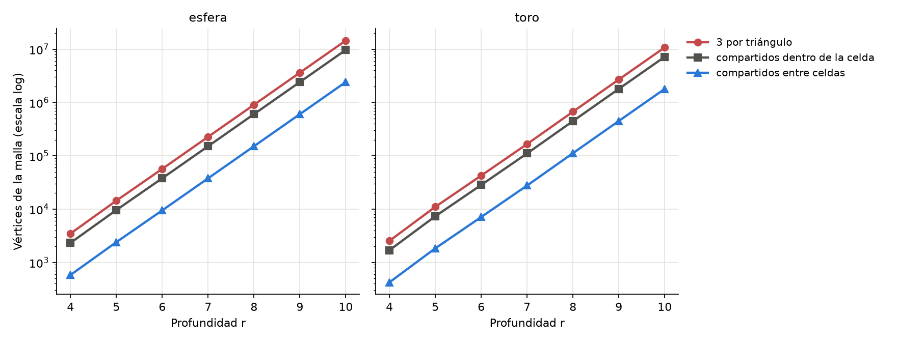
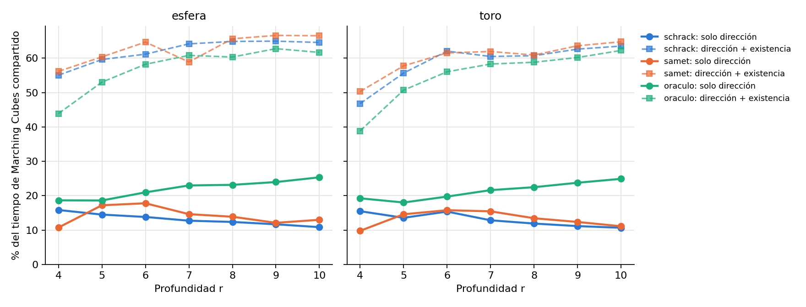
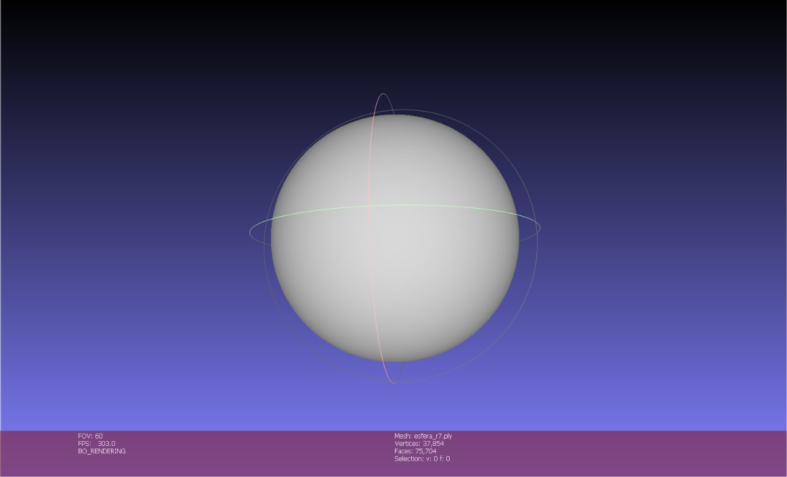
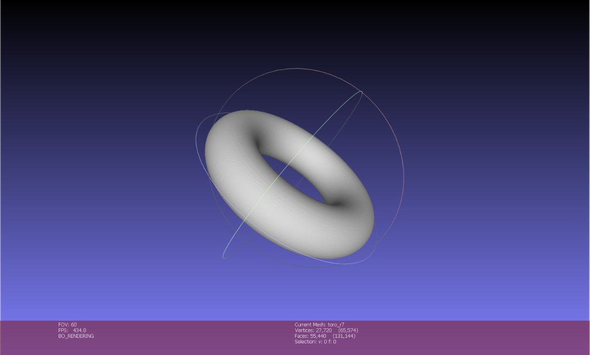

# Vecinos de igual tamaño en octrees lineales: una aplicación a Marching Cubes

Proyecto de curso I de **CS3014 Estructuras de Datos Avanzadas** (UTEC).

Integrantes: Irán María Alvarez Flores, Harold Canto Vidal y Luis Fernando Izaguirre Zavaleta.

Paper base: G. Schrack, *Finding neighbors of equal size in linear quadtrees and octrees in constant time*, CVGIP: Image Understanding 55(3), 1992.

---

## Descripción

Un octree guarda un volumen 3D partiendo el cubo en 8 cubitos, y cada cubito en otros 8, hasta una profundidad `r`. En un **octree lineal** no hay punteros: cada hoja es un número (su *location code*, con los bits de x, y, z intercalados) y el árbol es un arreglo ordenado de esos números.

Marching Cubes necesita, para cada celda de la superficie, el **vecino del mismo tamaño**, para reutilizar los vértices que ese vecino ya calculó. El proyecto implementa dos formas de calcular su dirección, las compara y las integra a Marching Cubes:

| Método | Idea | Costo |
|---|---|---|
| **Samet (1989)**, reflexión de dígitos | Recorre los dígitos del código desde el último nivel, reflejándolos, hasta llegar al ancestro común. | O(r) en el peor caso, O(1) en promedio |
| **Schrack (1992)**, enteros dilatados | Separa los bits de cada coordenada con huecos; el vecino sale de una suma de enteros y unas máscaras. | O(1), no recorre niveles |

Además se usa un tercer método, el **oráculo** (decodifica a x, y, z, suma 1 y vuelve a codificar). Es lento, pero obviamente correcto, y sirve para comprobar a los otros dos.

### Objetivos

| # | Objetivo |
|---|---|
| 1 | Implementar dilatación, contracción y suma dilatada, y medir la dirección del vecino (Schrack frente a Samet) en el peor caso y en el promedio, con r entre 4 y 10. |
| 2 | Implementar el octree lineal y medir la búsqueda completa de un vecino: dirección más verificación de que existe (búsqueda binaria; tabla hash como extra). |
| 3 | Marching Cubes con vértices compartidos: fracción del tiempo que ocupa la búsqueda de vecinos y reducción de vértices. |
| 4 | Verificar la corrección: los métodos coinciden, la malla es válida y se reproducen los ejemplos del paper. |

---

## Arquitectura



El flujo es: se define una superficie, se construye el octree subdividiendo hasta la profundidad `r` toda celda que la superficie cruza, y Marching Cubes recorre esas celdas. Para compartir un vértice, cada celda calcula la dirección de su vecina (con Schrack, Samet o el oráculo) y comprueba que existe en el arreglo.

### Estructura del repositorio

```
Proyecto-EDA/
├── include/
│   ├── octree.h            # Code, Hoja, las 18 direcciones, encode y decode
│   ├── vecinos.h           # enteros dilatados
│   ├── octree_lineal.h     # construirOctree, hasLeaf, hasLeafHash
│   ├── superficies.h       # esfera, toro y el test conservador canCross
│   ├── marching_cubes.h    # tipos y funciones de Marching Cubes
│   └── tablas.h            # tablas de Marching Cubes (edgeTable, triTable)
├── src/
│   ├── vecinos.cpp         # dilatar, contraer, sumaDilatada, schrack, samet, oracle
│   ├── octree_lineal.cpp   # construcción del octree, búsqueda binaria y hash
│   ├── celdas_superficie.cpp
│   ├── mc_baseline.cpp     # Marching Cubes sin compartir (mcSoup y mcPerCell)
│   ├── mc_compartido.cpp   # Marching Cubes con vértices compartidos y consultas
│   ├── main_mc.cpp         # benchmark del objetivo 3
│   ├── bench_vecinos.cpp   # benchmark del objetivo 1
│   └── bench_octree.cpp    # benchmark del objetivo 2
├── tests/
│   ├── test_vecinos.cpp    # ejemplos del paper y coincidencia entre métodos
│   ├── test_octree.cpp     # octree, existencia y consultas de Marching Cubes
│   └── test_malla.cpp      # validez de la malla
├── scripts/                # graficar_obj1.py, graficar_obj2.py, graficar_obj3.py
├── results/                # CSV y figuras de los tres benchmarks
└── Makefile
```

---

## Requisitos

| Recurso | Necesario |
|---|---|
| Sistema | 64 bits (Windows, Linux o macOS). Los location codes son `uint64_t`. |
| Compilador | g++ con C++17 (probado con g++ 16.1 de MSYS2 en Windows 11). |
| Herramienta de compilación | `make` (GNU). |
| Python | Python 3 con `matplotlib` (`pip install matplotlib`), solo para las figuras. |
| Memoria | Unos 2 GB de RAM libres para el objetivo 2 con r = 10 (el toro tiene 32.5 millones de hojas y la tabla hash las guarda todas). Con r ≤ 8 basta mucho menos. |
| Disco | Unos 5 MB para `results/`, más 4.4 MB de las mallas `.ply` si se corre el objetivo 3. |

No hay dependencias externas de C++: solo la librería estándar. Las tablas de Marching Cubes están en `include/tablas.h`.

---

## Compilación

Todos los comandos se corren desde la raíz del repositorio.

```bash
make
```

Los ejecutables quedan en `bin/` (`bench_vecinos`, `bench_octree`, `mc`, `test_vecinos`, `test_octree`, `test_malla`). Todo se compila con `-O2 -std=c++17 -Wall -Wextra` y corre en un solo hilo. En Windows el Makefile enlaza con `-static`.

### Windows con MSYS2

1. Instalar MSYS2 y, desde su terminal, `pacman -S mingw-w64-x86_64-gcc make`.
2. Poner en el `PATH` primero `C:\msys64\mingw64\bin` y después `C:\msys64\usr\bin`. El orden importa: si `usr\bin` va primero, `make` usa el `g++` de MSYS, los `.exe` quedan dependiendo de `msys-2.0.dll` y fallan al ejecutarse con el código `0xC0000135`.
3. Compilar y correr desde PowerShell. Los ejecutables se llaman con `bin\bench_octree.exe 10`.

Si no hay `make`, cada programa se compila a mano. Por ejemplo, el objetivo 3:

```bash
g++ -O2 -std=c++17 -Iinclude src/main_mc.cpp src/mc_baseline.cpp src/celdas_superficie.cpp src/mc_compartido.cpp src/vecinos.cpp -o bin/mc
```

---

## Tests

```bash
make test
```

La salida termina con `Todos los tests pasaron` (dos veces) y `Todos los tests de malla pasaron`. Si algo falla, se imprime una línea `FALLA` con el nombre de la prueba.

| Programa | Qué comprueba |
|---|---|
| `test_vecinos` | Los ejemplos numéricos del paper (dilataciones de la figura 3, suma de location codes) y que Schrack = Samet = oráculo con códigos aleatorios (semilla 2026). |
| `test_octree` | Para la esfera y el toro con r = 4…7: hojas ordenadas y sin duplicados; volumen total igual a 1; las celdas de superficie son hojas de nivel r; existen las 4 celdas de cada arista cortada; `hasLeaf` y `hasLeafHash` coinciden con un `std::set`; los tres métodos dan el mismo código en todas las consultas de Marching Cubes y la vecina existe. |
| `test_malla` | Para la esfera y el toro con r = 4…7: no falta ninguna vecina; la malla compartida es idéntica con los tres métodos; los índices son válidos y no hay vértices huérfanos; la malla es cerrada (cada arista está en exactamente 2 triángulos); los triángulos coinciden con los de la versión sin compartir (coordenadas redondeadas a 1e-9, porque una misma arista recorrida en sentido contrario difiere en el último bit del `double`); vértices de compartida < por celda < 3 por triángulo. |

---

## Ejecución de los experimentos

Cada benchmark recibe como argumento la **profundidad máxima** (por defecto 10) y recorre r = 4 hasta ese valor, para la esfera y el toro. Se corren desde la raíz, porque escriben en `results/`.

| Objetivo | Comando | Genera en `results/` |
|---|---|---|
| 1 | `bin/bench_vecinos 10` y luego `python scripts/graficar_obj1.py` | `obj1.csv`, `obj1_resumen.csv`, `obj1_tiempo_{peor,azar}_{caras,aristas}.png`, `obj1_digitos.png` |
| 2 | `bin/bench_octree 10` y luego `python scripts/graficar_obj2.py` | `obj2.csv`, `obj2_resumen.csv`, `obj2_total.png`, `obj2_componentes.png` |
| 3 | `bin/mc 10` y luego `python scripts/graficar_obj3.py` | `obj3.csv`, `obj3_resumen.csv`, `obj3_vertices.png`, `obj3_tiempo.png`, `obj3_fraccion.png`, `esfera_r7.ply`, `toro_r7.ply` |

Cada ejecución **sobrescribe** los CSV del objetivo correspondiente.

### Duración

Medido en una laptop con Windows 11:

| Profundidad máxima | `bench_vecinos` | `bench_octree` | `mc` |
|---|---|---|---|
| 7 | 16 s | 56 s | 24 s |
| 10 | unos 8 minutos los tres juntos | | |

Para una prueba rápida basta con `7` como argumento.

### Formato de los CSV

| Archivo | Columnas |
|---|---|
| `obj1.csv` (una fila por corrida) | `r, caso, tipo, metodo, corrida, ns_por_consulta, digitos_reflejados` |
| `obj2.csv` (una fila por corrida) | `superficie, r, hojas, celdas, consultas, vueltas, ms_octree, ms_tabla, metodo, estructura, corrida, ns_direccion, ns_existencia, ns_total` |
| `obj3.csv` (una fila por método) | `superficie, r, celdas, metodo, t_por_celda, t_sopa, t_compartido, t_direccion, t_busqueda, fraccion_direccion, fraccion_busqueda, v_sopa, v_por_celda, v_compartido, triangulos` |

Los valores de `caso` son `peor` y `azar`, los de `tipo` son `caras` y `aristas`, los de `metodo` son `schrack`, `samet` y `oraculo`, y los de `estructura` son `binaria` y `hash`. Los tiempos del objetivo 1 y 2 están en nanosegundos por consulta, y los del objetivo 3 en segundos. Los scripts de Python generan los `*_resumen.csv` y las figuras a partir de los CSV crudos, así que se pueden volver a graficar sin repetir el benchmark.

### Recomendaciones para medir

- Conectar la laptop a la corriente y cerrar otros programas pesados. Los tiempos se perturban con facilidad.
- Cada medición se repite 5 veces y se reporta el **mínimo**, porque el ruido del sistema solo suma tiempo. Los CSV de los objetivos 1 y 2 guardan las 5 corridas crudas para ver la dispersión.
- Los resultados cambian de una máquina a otra, y los tiempos de este README son de una sola laptop. Los conteos (hojas, celdas, vértices, dígitos reflejados) sí son exactamente reproducibles. Las consultas del objetivo 1 usan una semilla fija (2026).
- `bin/mc` necesita que exista la carpeta `results/`, que ya viene en el repositorio. Si falta, avisa y termina.

---

## Metodología

| Parámetro | Valor |
|---|---|
| Esfera | centro (0.5, 0.5, 0.5), radio 0.35, constante de Lipschitz 1.74 |
| Toro | centro (0.5, 0.5, 0.5), radio mayor 0.3, radio menor 0.1, constante de Lipschitz 1.30 |
| Dominio | cubo [0, 1]³ |
| Profundidad | r = 4…10 (de 16 a 1024 celdas por eje) |
| Direcciones | 18: 6 caras y 12 aristas |
| Repeticiones | 5 por medición, se reporta el mínimo |
| Hilos | 1 |

- **Construcción del octree.** Una celda de lado `a` y centro `p` no puede contener la superficie `F = 0` si `|F(p)| > L · a · √3 / 2`, donde `L` es la constante de Lipschitz. En ese caso se guarda como hoja grande. Si no, se subdivide hasta el nivel `r`. Es el mismo test que usa Marching Cubes para encontrar las celdas de superficie, así que toda celda de superficie es una hoja de nivel `r`, y también lo son las 4 celdas que comparten cada arista cortada. Por eso nunca hace falta buscar vecinos de otro tamaño.
- **Objetivo 1.** 2²⁰ consultas por medición, en dos grupos. El *peor caso* son celdas cuya coordenada obliga a reflejar todos los dígitos (Samet recorre los `r` niveles). El *promedio* son celdas elegidas al azar.
- **Objetivo 2.** Usa las mismas consultas que hace Marching Cubes (las vecinas por cara y por arista de cada celda de superficie), así que `N` crece con `r`. Si hay pocas consultas, el lote se repite hasta llegar a 2²⁰ consultas por medición. Antes de medir se verifica que los tres métodos den el mismo código y que la vecina exista en las dos estructuras.
- **Objetivo 3.** Cada pasada se repite hasta acumular 50 ms. `fraccion_direccion` es el tiempo de calcular solo las direcciones dividido por el tiempo de la malla compartida, y `fraccion_busqueda` incluye además la verificación de existencia.
- **Versiones de Marching Cubes que se comparan.** `mcSoup` (3 vértices por triángulo, la versión clásica), `mcPerCell` (los vértices se comparten dentro de la celda) y `mcShared` (se comparten entre celdas vecinas, la que usa el vecino).

---

## Resultados

Todos los números salen de los CSV de `results/`, corridos en una sola laptop conectada a la corriente, con el mínimo de 5 corridas.

### Objetivo 1: dirección del vecino

Tiempo para calcular la dirección del vecino por cara, en nanosegundos por consulta:

| Caso | r | Schrack | Samet | Oráculo | Dígitos que refleja Samet |
|---|---|---|---|---|---|
| Peor caso | 4 | 41 | 42 | 34 | 4 |
| Peor caso | 7 | 43 | 49 | 52 | 7 |
| Peor caso | 10 | 52 | 57 | 84 | 10 |
| Azar | 4 | 44 | 50 | 35 | 1.6 |
| Azar | 7 | 42 | 51 | 53 | 1.9 |
| Azar | 10 | 42 | 51 | 74 | 2.0 |




- **Los dígitos reflejados confirman la teoría.** En el peor caso Samet refleja exactamente `r` dígitos (4, 7, 10). Al azar refleja casi siempre 2 (de 1.6 a 2.0 en las caras), sin importar cuán profundo sea el árbol. Por eso el promedio de Samet ya es O(1).
- **Schrack se mantiene casi plano** en el peor caso con caras: entre 41 y 43 ns de r = 4 a r = 9, y 52 ns en r = 10. Samet sube de 42 a 57 ns y el oráculo de 34 a 84 ns.
- **La diferencia entre Schrack y Samet es chica con caras** (de 1 a 5 ns en el peor caso). A estos tamaños, 10 niveles son pocas operaciones.
- **Con aristas la diferencia se ve más.** En el peor caso, Schrack se queda en 55, 55 y 54 ns (r = 4, 7 y 10), mientras Samet sube de 62 a 77 y 101 ns. Hay un punto ruidoso de Schrack en r = 6 (75 ns). Para r pequeño, el oráculo es el más rápido (34 ns en r = 4) y solo lo supera Schrack desde r = 7. Las figuras están en `results/obj1_tiempo_peor_aristas.png` y `results/obj1_tiempo_azar_aristas.png`.
- **Al azar, Schrack y Samet casi no cambian con r.** Es lo esperado: Samet refleja solo 2 dígitos.

### Objetivo 2: verificación de existencia

Calcular la dirección no dice si esa celda está en el árbol. Hay que buscarla en el arreglo ordenado (búsqueda binaria, O(log N)) o en una tabla hash (O(1) esperado).

Con r = 10, en nanosegundos por consulta:

| Superficie | Hojas | Método | Estructura | Dirección | Existencia | Total |
|---|---|---|---|---|---|---|
| esfera | 16.2 M | Schrack | binaria | 27 | 138 | 197 |
| esfera | 16.2 M | Schrack | hash | 16 | 79 | 130 |
| esfera | 16.2 M | Samet | binaria | 26 | 121 | 204 |
| esfera | 16.2 M | oráculo | binaria | 106 | 243 | 290 |
| toro | 32.5 M | Schrack | binaria | 26 | 136 | 184 |
| toro | 32.5 M | Schrack | hash | 27 | 66 | 108 |
| toro | 32.5 M | Samet | binaria | 12 | 60 | 86 |


- **Verificar la existencia pesa más que calcular la dirección.** Con Schrack y búsqueda binaria, la existencia es el 70 % (esfera) y el 74 % (toro) del total en r = 10.
- **En las consultas de Marching Cubes, Schrack y Samet cuestan casi lo mismo** (de 12 a 27 ns por dirección). Las vecinas están cerca, así que comparten un ancestro cercano y Samet casi no recorre niveles.
- **La tabla hash baja el total** de 197 a 130 ns en la esfera y de 184 a 108 ns en el toro, es decir, entre 1.5 y 1.7 veces.
- **Pero construir la tabla es caro.** Con r = 10 tarda 3.5 s en la esfera y 5.4 s en el toro, mientras construir el octree toma 2.2 s y 1.9 s. Para una sola pasada de Marching Cubes, la tabla no se paga sola.
- **La fila de Samet con búsqueda binaria en el toro no es confiable.** Da 60 ns de existencia, contra unos 136 ns de Schrack con la misma estructura y las mismas consultas. La verificación no depende del método, así que esa diferencia es ruido.

### Objetivo 3: Marching Cubes con vértices compartidos

Vértices de la malla con la esfera:

| r | Celdas | 3 por triángulo | Compartidos en la celda | Compartidos entre celdas |
|---|---|---|---|---|
| 4 | 584 | 3 480 | 2 328 | 582 |
| 7 | 37 856 | 227 112 | 151 416 | 37 854 |
| 10 | 2 421 200 | 14 527 176 | 9 684 792 | 2 421 198 |



- **La malla compartida tiene 6 veces menos vértices** que la de 3 por triángulo, y 4 veces menos que la que solo comparte dentro de la celda. La proporción es la misma en todas las profundidades y en las dos superficies.
- **Casi no sobran vértices:** hay 582 vértices para 584 celdas con r = 4, es decir, aproximadamente un vértice por celda de superficie.

Tiempo total con r = 10 (en segundos, con Schrack):

| Superficie | 3 por triángulo | Compartidos en la celda | Compartidos entre celdas |
|---|---|---|---|
| esfera | 0.46 | 0.44 | 1.61 |
| toro | 0.39 | 0.38 | 1.20 |


- **Compartir vértices entre celdas es más lento** (3.5 veces en la esfera, 3.2 en el toro). Hay que buscar a los vecinos y verificar que existen. Se gana en vértices y se pierde en tiempo.

Parte de ese tiempo que se va en buscar vecinos, con r = 10:

| Superficie | Método | Solo la dirección | Dirección + existencia |
|---|---|---|---|
| esfera | Schrack | 11 % | 65 % |
| esfera | Samet | 13 % | 67 % |
| esfera | oráculo | 25 % | 62 % |
| toro | Schrack | 11 % | 64 % |
| toro | Samet | 11 % | 65 % |
| toro | oráculo | 25 % | 62 % |



- **Calcular la dirección es poco** (11 % con Schrack), y Schrack y Samet casi empatan.
- **Dirección más existencia es el 62 % al 67 %**, para cualquiera de los tres métodos. La búsqueda binaria domina y borra la diferencia entre los métodos.
- **El oráculo sí se nota** (25 %). Es el único que decodifica y vuelve a codificar.
- **La fracción de dirección más existencia es sensible al ruido.** Se calcula con pasadas medidas por separado y en profundidades pequeñas a veces da más de 100 %. Es ruido de la máquina, no un resultado.

### Objetivo 4: corrección

`make test` pasa completo (ver la sección Tests). En resumen, Schrack, Samet y el oráculo devuelven el mismo código con códigos aleatorios y en todas las consultas reales de Marching Cubes. La malla compartida es idéntica con los tres métodos, es cerrada y sus triángulos coinciden con los de la versión sin compartir.

Como comprobación visual, `bin/mc` guarda las mallas con r = 7 en `results/esfera_r7.ply` y `results/toro_r7.ply`, y se abrieron en MeshLab. Las dos superficies se ven continuas y sin huecos, y los conteos que muestra MeshLab coinciden con `results/obj3.csv`.

| Malla | Vértices | Caras | Fuente de los conteos |
|---|---|---|---|
| esfera, r = 7 | 37 854 | 75 704 | `obj3.csv`: `v_compartido` y `triangulos` |
| toro, r = 7 | 27 720 | 55 440 | `obj3.csv`: `v_compartido` y `triangulos` |





## Conclusiones

1. **El método de Schrack funciona y es correcto.** Coincide con Samet y con el oráculo en todas las pruebas, incluyendo la malla completa.
2. **El O(1) se ve, pero la ventaja es pequeña.** Schrack casi no cambia con `r` (41 a 52 ns en el peor caso con caras), y Samet sube de 42 a 57 ns porque refleja `r` dígitos. Con aristas la diferencia es mayor (54 frente a 101 ns en r = 10). Con r ≤ 10, igual, la ganancia en nanosegundos es chica.
3. **El promedio de Samet ya es O(1).** Al azar solo refleja unos 2 dígitos, y por eso casi no pierde frente a Schrack.
4. **En Marching Cubes lo que domina es verificar que el vecino existe,** no calcular su dirección. Con búsqueda binaria es casi dos tercios del tiempo. La tabla hash ayuda (hasta 1.7 veces), pero construirla cuesta más que lo que ahorra en una sola pasada.
5. **Compartir vértices reduce 6 veces los vértices de la malla,** a cambio de que el programa sea unas 3 veces más lento.

---

## Limitaciones

- **Los tiempos siguen teniendo algo de ruido.** Aunque se reporta el mínimo de 5 corridas, hay puntos aislados que no son reales (la fila de Samet en el toro del objetivo 2 y el pico de Schrack en r = 6 con aristas). Para cerrar mejor la comparación habría que repetir en una máquina más estable o con más corridas.
- **Solo se cubren vecinos de igual tamaño.** El criterio de subdivisión garantiza que las celdas que comparten una arista cortada sean todas de nivel r, así que el caso de vecinos de otro tamaño no se presenta.
- **Con enteros de 64 bits** la resolución máxima es r = 20, que alcanza de sobra para r = 10.
- **No hay visualizador.** La malla se guarda como `.ply` (solo para r = 7) y se puede abrir con cualquier visor, por ejemplo MeshLab.


## Referencias

1. I. Gargantini. *An effective way to represent quadtrees*. Communications of the ACM, 25(12):905–910, 1982.
2. I. Gargantini. *Linear octtrees for fast processing of three-dimensional objects*. Computer Graphics and Image Processing, 20(4):365–374, 1982.
3. W. E. Lorensen y H. E. Cline. *Marching cubes: a high resolution 3D surface construction algorithm*. SIGGRAPH '87, pp. 163–169, 1987.
4. H. Samet. *Neighbor finding techniques for images represented by quadtrees*. Computer Graphics and Image Processing, 18(1):37–57, 1982.
5. H. Samet. *Neighbor finding in images represented by octrees*. Computer Vision, Graphics, and Image Processing, 46(3):367–386, 1989.
6. G. Schrack. *Finding neighbors of equal size in linear quadtrees and octrees in constant time*. CVGIP: Image Understanding, 55(3):221–230, 1992.
