# Vecinos de igual tamaño en octrees lineales: una aplicación a Marching Cubes

Proyecto de curso I · **CS3014 Estructuras de Datos Avanzadas** · Universidad de Ingeniería y Tecnología (UTEC) · 2026-2

**Integrantes:** Irán María Alvarez Flores, Harold Canto Vidal y Luis Fernando Izaguirre Zavaleta

**Docente:** Víctor Racsó Galván Oyola

**Artículo base:** G. Schrack, *Finding neighbors of equal size in linear quadtrees and octrees in constant time*, CVGIP: Image Understanding 55(3), 221–230, 1992.

---

## Contenido

1. [Resumen](#resumen)
2. [Descripción del problema](#descripción-del-problema)
3. [Arquitectura](#arquitectura)
4. [Requisitos](#requisitos)
5. [Compilación](#compilación)
6. [Pruebas](#pruebas)
7. [Ejecución de los experimentos](#ejecución-de-los-experimentos)
8. [Metodología](#metodología)
9. [Resultados](#resultados)
10. [Conclusiones](#conclusiones)
11. [Limitaciones](#limitaciones)
12. [Referencias](#referencias)

---

## Resumen

El proyecto implementa en C++17 un octree lineal y dos métodos para calcular el código del vecino de igual tamaño de una hoja: la **reflexión de dígitos de Samet**, de costo O(r) en el peor caso, y la **suma dilatada de Schrack**, de costo O(1). Ambos se comparan de forma aislada, dentro de una búsqueda completa con verificación de existencia y dentro de una variante de **Marching Cubes con vértices compartidos**.

Resultados principales con r = 10:

| Pregunta | Respuesta |
|---|---|
| ¿Se observa el tiempo constante de Schrack? | **Sí.** Su tiempo no cambia entre r = 4 y r = 10 (cociente 1.01), mientras que Samet crece un 51 % por arista en el peor caso. |
| ¿Cuánto pesa verificar que el vecino existe? | **Domina la consulta.** Con búsqueda binaria es entre el 72 % y el 74 % del tiempo de la consulta completa. |
| ¿Qué efecto tiene en Marching Cubes? | La malla compartida usa **6 veces menos vértices** y tarda unas 3.5 veces más. Con Schrack es un 4 % más rápida que con Samet. |

---

## Descripción del problema

Un octree divide recursivamente el dominio en ocho octantes hasta una profundidad máxima `r`. En un **octree lineal** no hay punteros: cada hoja se representa por su *location code*, que intercala los bits de las coordenadas `x`, `y`, `z` de su esquina, junto con su nivel. El árbol se guarda como un arreglo ordenado de pares (código, nivel).

Marching Cubes interpola un vértice en cada arista de la rejilla que corta la superficie. Una arista interior pertenece a cuatro celdas, así que, para no calcular el mismo vértice varias veces, cada celda debe localizar a la celda vecina que ya lo calculó. Esa consulta tiene dos pasos:

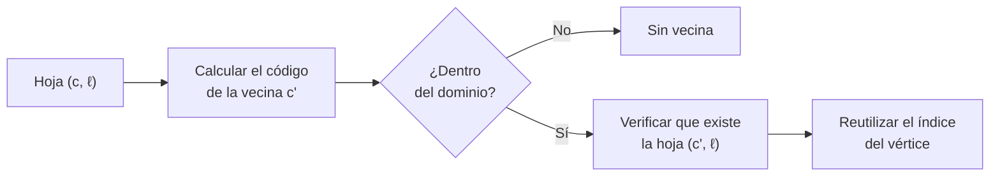

El proyecto compara tres formas de resolver el primer paso y dos formas de resolver el segundo:

| Paso | Método | Idea | Costo |
|---|---|---|---|
| Dirección | **Samet (1989)**, reflexión de dígitos | Invierte los bits del eje desplazado, desde el nivel más profundo, hasta que termina el acarreo. | O(r) en el peor caso, O(1) esperado |
| Dirección | **Schrack (1992)**, suma dilatada | Suma un incremento al código intercalado usando máscaras que rellenan los huecos entre bits de un mismo eje. | O(1) |
| Dirección | **Oráculo** | Decodifica a (x, y, z), suma el desplazamiento y vuelve a codificar. Se usa como referencia de corrección. | O(r) |
| Existencia | **Búsqueda binaria** | Busca el par (código, nivel) en el arreglo ordenado de hojas. | O(log N) |
| Existencia | **Tabla hash** | `std::unordered_set` con las mismas hojas. | O(1) esperado, O(N) de memoria adicional |

### Objetivos

| # | Objetivo |
|---|---|
| 1 | Implementar dilatación, contracción y suma dilatada, y medir el cálculo de la dirección del vecino con Schrack y con Samet, en el peor caso y con coordenadas aleatorias, para r entre 4 y 10. |
| 2 | Implementar el octree lineal y medir la búsqueda completa del vecino: dirección más verificación de existencia, con búsqueda binaria y con tabla hash. |
| 3 | Implementar Marching Cubes con vértices compartidos y medir qué fracción del tiempo ocupa la búsqueda de vecinos y cuánto se reduce el número de vértices. |
| 4 | Verificar la corrección: los tres métodos coinciden, la malla es válida y se reproducen los ejemplos numéricos del artículo. |

---

## Arquitectura

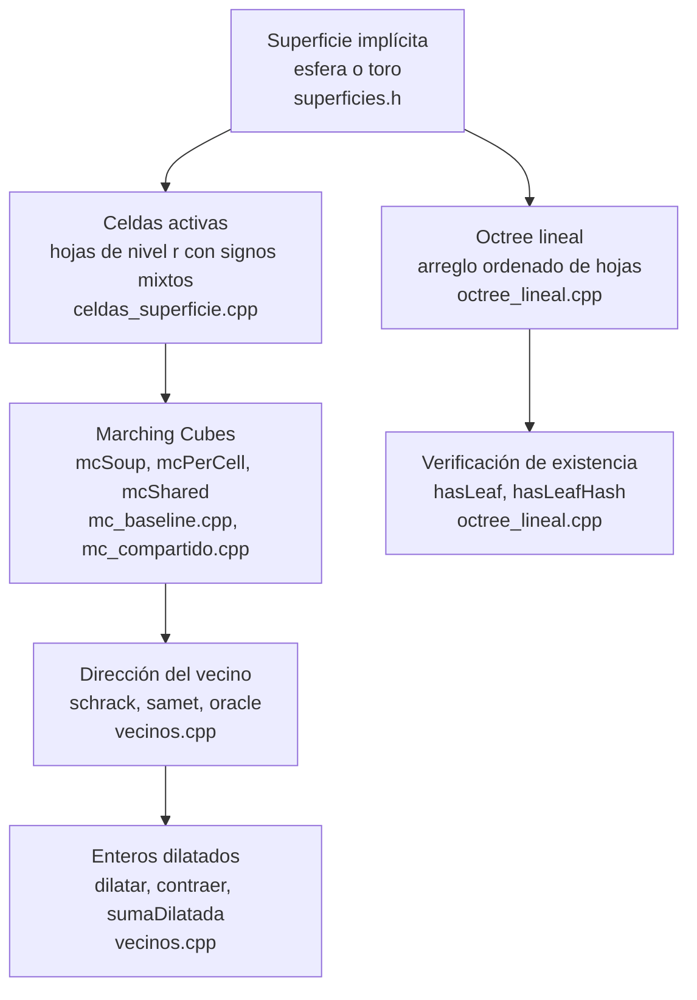

El octree completo y las celdas activas se construyen con la misma poda: una celda se descarta si la superficie no puede cruzarla (ver [Metodología](#metodología)). El benchmark de existencia consulta las `N` hojas del octree completo; el mallado consulta por búsqueda binaria las `M` celdas activas.

### Marching Cubes con vértices compartidos

`mcShared` recorre las celdas activas dos veces. Cada celda es propietaria de tres aristas: las que salen de su esquina mínima en +x, +y y +z.

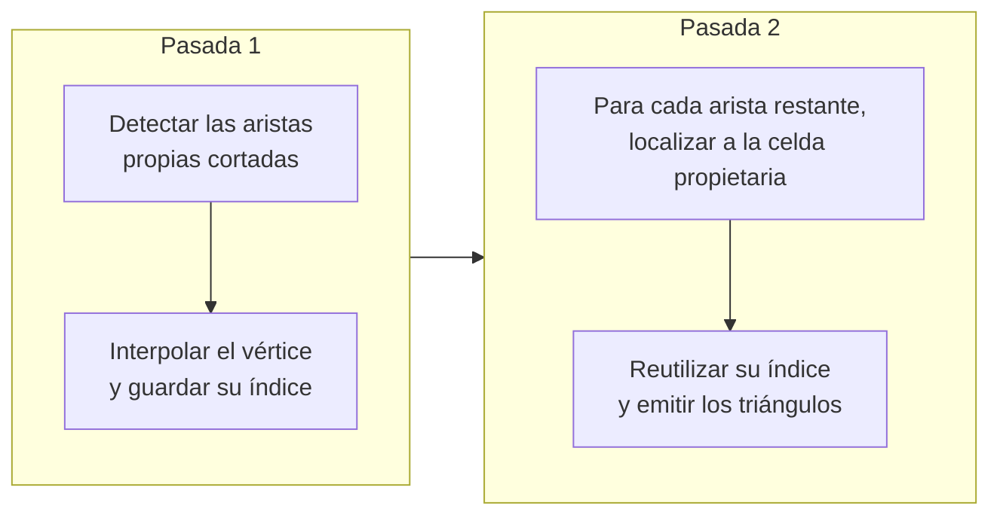

Las tres variantes que se comparan reciben las mismas celdas activas:

| Variante | Vértices que reutiliza | Consultas a vecinas |
|---|---|---|
| `mcSoup` | Ninguno: emite tres vértices por triángulo. | Ninguna |
| `mcPerCell` | Los de las aristas de una misma celda. | Ninguna |
| `mcShared` | Los de las aristas compartidas entre celdas. | Dirección y búsqueda binaria |

### Estructura del repositorio

```
Proyecto-EDA/
├── include/
│   ├── octree.h            # Code, Hoja, las 18 direcciones, encode y decode
│   ├── vecinos.h           # enteros dilatados y métodos de vecinos
│   ├── octree_lineal.h     # construirOctree, construirTabla, hasLeaf, hasLeafHash
│   ├── superficies.h       # esfera, toro y la poda canCross
│   ├── marching_cubes.h    # tipos y funciones de Marching Cubes
│   └── tablas.h            # tablas de Marching Cubes (edgeTable, triTable)
├── src/
│   ├── vecinos.cpp         # dilatar, contraer, sumaDilatada, schrack, samet, oracle
│   ├── octree_lineal.cpp   # construcción del octree, búsqueda binaria y tabla hash
│   ├── celdas_superficie.cpp
│   ├── mc_baseline.cpp     # mcSoup y mcPerCell
│   ├── mc_compartido.cpp   # mcShared y las consultas de vecinos del mallado
│   ├── bench_vecinos.cpp   # benchmark del objetivo 1
│   ├── bench_octree.cpp    # benchmark del objetivo 2
│   └── main_mc.cpp         # benchmark del objetivo 3
├── tests/
│   ├── test_vecinos.cpp
│   ├── test_octree.cpp
│   └── test_malla.cpp
├── scripts/                # graficar_obj1.py, graficar_obj2.py, graficar_obj3.py
├── results/                # CSV, resúmenes, tablas y figuras
└── Makefile
```

---

## Requisitos

| Recurso | Requisito |
|---|---|
| Sistema | 64 bits (Windows, Linux o macOS). Los location codes son `uint64_t`. |
| Compilador | g++ con soporte de C++17. Probado con g++ 16.1 (MSYS2) en Windows 11. |
| Compilación | GNU `make` (opcional, ver [Compilación](#compilación)). |
| Python | Python 3 con `matplotlib`, solo para las figuras: `pip install matplotlib`. |
| Memoria | Unos 2 GB libres para el objetivo 2 con r = 10. El toro tiene 32.5 millones de hojas y la tabla hash las guarda todas. |
| Disco | Unos 5 MB para `results/`, más 4.4 MB de las mallas `.ply`. |

El código solo usa la biblioteca estándar de C++.

---

## Compilación

Desde la raíz del repositorio:

```bash
make
```

Los ejecutables quedan en `bin/`: `bench_vecinos`, `bench_octree`, `mc`, `test_vecinos`, `test_octree` y `test_malla`. Todo se compila con `-O2 -std=c++17 -Wall -Wextra` y se ejecuta en un solo hilo. En Windows el Makefile enlaza con `-static`.

### Windows con MSYS2

1. Instalar MSYS2 y, desde su terminal, ejecutar `pacman -S mingw-w64-x86_64-gcc make`.
2. Agregar al `PATH` primero `C:\msys64\mingw64\bin` y después `C:\msys64\usr\bin`. Si `usr\bin` va primero, `make` usa el `g++` de MSYS, los ejecutables dependen de `msys-2.0.dll` y fallan con el código `0xC0000135`.
3. Compilar y ejecutar desde PowerShell, por ejemplo `bin\bench_octree.exe 10`.

### Sin `make`

Cada programa se puede compilar directamente con `g++`:

```bash
g++ -O2 -std=c++17 -Wall -Wextra -Iinclude src/bench_vecinos.cpp src/vecinos.cpp -o bin/bench_vecinos.exe -static
g++ -O2 -std=c++17 -Wall -Wextra -Iinclude src/bench_octree.cpp src/octree_lineal.cpp src/vecinos.cpp src/celdas_superficie.cpp src/mc_compartido.cpp -o bin/bench_octree.exe -static
g++ -O2 -std=c++17 -Wall -Wextra -Iinclude src/main_mc.cpp src/mc_baseline.cpp src/celdas_superficie.cpp src/mc_compartido.cpp src/vecinos.cpp -o bin/mc.exe -static
```

En Linux o macOS se omiten `.exe` y `-static`.

---

## Pruebas

```bash
make test
```

La salida termina con `Todos los tests pasaron` (dos veces) y `Todos los tests de malla pasaron`. Si una prueba falla, se imprime una línea `FALLA` con su nombre.

| Programa | Qué comprueba |
|---|---|
| `test_vecinos` | Los ejemplos numéricos del artículo (ver [Objetivo 4](#objetivo-4-corrección)) y que Schrack, Samet y el oráculo coinciden en 200 000 consultas aleatorias (semilla 12345), variando profundidad, nivel y dirección. |
| `test_octree` | Para la esfera y el toro con r = 4…7: hojas ordenadas y sin duplicados; volumen total igual a 1; las celdas activas son hojas de nivel r; existen las cuatro celdas de cada arista cortada; `hasLeaf` y `hasLeafHash` coinciden con un `std::set`; los tres métodos dan el mismo código en todas las consultas de Marching Cubes. |
| `test_malla` | Para la esfera y el toro con r = 4…7: no falta ninguna vecina; la malla compartida es idéntica con los tres métodos; los índices son válidos y no hay vértices sin usar; la malla es cerrada (cada arista está en exactamente dos triángulos); los triángulos coinciden con los de `mcSoup` tras redondear las coordenadas a 10⁻⁹. |

---

## Ejecución de los experimentos

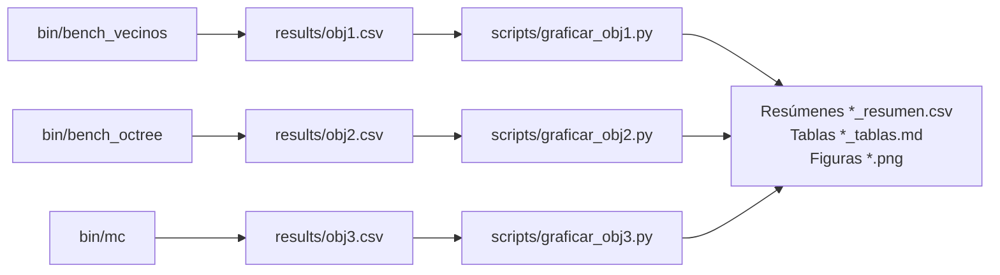

Cada benchmark recibe como argumento la profundidad máxima (por defecto 10) y recorre desde r = 4 hasta ese valor, para la esfera y el toro. Se ejecutan desde la raíz del repositorio, porque escriben en `results/`.

```bash
bin/bench_vecinos 10
bin/bench_octree 10
bin/mc 10
python scripts/graficar_obj1.py
python scripts/graficar_obj2.py
python scripts/graficar_obj3.py
```

| Objetivo | Programa | Archivos que genera en `results/` |
|---|---|---|
| 1 | `bench_vecinos` y `graficar_obj1.py` | `obj1.csv`, `obj1_resumen.csv`, `obj1_tablas.md`, `obj1_tiempo_{peor,azar}_{caras,aristas}.png`, `obj1_digitos.png` |
| 2 | `bench_octree` y `graficar_obj2.py` | `obj2.csv`, `obj2_resumen.csv`, `obj2_tablas.md`, `obj2_total.png`, `obj2_componentes.png` |
| 3 | `mc` y `graficar_obj3.py` | `obj3.csv`, `obj3_resumen.csv`, `obj3_tablas.md`, `obj3_vertices.png`, `obj3_tiempo.png`, `obj3_fraccion.png`, `esfera_r7.ply`, `toro_r7.ply` |

Cada ejecución sobrescribe los archivos de su objetivo. Con r = 10, los tres benchmarks tardan en total unos 15 minutos en una laptop con Windows 11. Para una prueba rápida basta con `6` como argumento.

### Formato de los CSV

Los tres CSV guardan una fila por corrida; los scripts calculan la mediana y el rango intercuartílico.

| Archivo | Columnas |
|---|---|
| `obj1.csv` | `r, caso, tipo, metodo, corrida, ns_por_consulta, digitos_reflejados` |
| `obj2.csv` | `superficie, r, hojas, celdas, consultas, vueltas, ms_octree, ms_tabla, metodo, estructura, corrida, ns_direccion, ns_existencia, ns_total` |
| `obj3.csv` | `superficie, r, celdas, metodo, corrida, t_por_celda, t_sopa, t_compartido, t_direccion, t_busqueda, v_sopa, v_por_celda, v_compartido, triangulos` |

Valores posibles: `caso` ∈ {`peor`, `azar`}, `tipo` ∈ {`caras`, `aristas`}, `metodo` ∈ {`schrack`, `samet`, `oraculo`} y `estructura` ∈ {`binaria`, `hash`}. Los tiempos de los objetivos 1 y 2 están en nanosegundos por consulta, y los del objetivo 3 en segundos.

### Recomendaciones para medir

- Conectar la laptop a la corriente, activar el plan de energía de máximo rendimiento y cerrar los demás programas.
- Los tiempos varían entre máquinas. Los conteos (hojas, celdas, vértices y dígitos reflejados) son exactamente reproducibles.
- `bin/mc` necesita que exista la carpeta `results/`, que ya está en el repositorio.

---

## Metodología

| Parámetro | Valor |
|---|---|
| Dominio | Cubo [0, 1]³ |
| Esfera | Centro (0.5, 0.5, 0.5), radio 0.35, constante de Lipschitz 1.74 |
| Toro | Centro (0.5, 0.5, 0.5), radio mayor 0.30, radio menor 0.10, constante de Lipschitz 1.30 |
| Profundidad | r = 4…10, es decir, de 16 a 1024 celdas por eje |
| Direcciones | 18: 6 por cara y 12 por arista |
| Compilación | C++17, `-O2`, un hilo |
| Repeticiones | 1 corrida de calentamiento y 11 corridas medidas, con los métodos intercalados |
| Estadístico | Mediana y rango intercuartílico (IQR) |

### Protocolo de medición

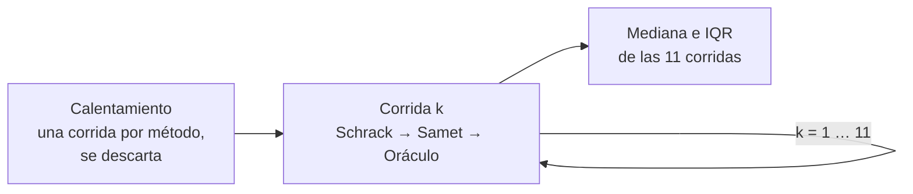

Los métodos se intercalan dentro de cada corrida para que el ruido de la máquina (frecuencia variable del procesador, temperatura u otros procesos) se reparta por igual entre ellos. En una primera versión se tomaba el mínimo de cinco corridas seguidas por método, y la misma operación llegó a variar hasta dos veces según el momento en que se ejecutaba. La mediana de corridas intercaladas no se ve afectada por una corrida atípica.

### Construcción del octree

Una celda de lado `a` y centro `p` no puede contener la superficie `F = 0` si

```
|F(p)| > L · a · √3 / 2
```

donde `L` es la constante de Lipschitz de `F` y `a · √3 / 2` es la semidiagonal de la celda. En ese caso se guarda como una hoja grande; si no, se subdivide hasta el nivel `r`. Como el mallado usa la misma poda, toda celda activa es una hoja de nivel `r`, y también lo son las cuatro celdas que comparten cada arista cortada. Por eso nunca hace falta buscar vecinos de otro tamaño.

| r | Esfera: hojas N | Esfera: celdas activas M | Toro: hojas N | Toro: celdas activas M |
|---|---|---|---|---|
| 4 | 3 032 | 584 | 3 032 | 424 |
| 6 | 61 440 | 9 488 | 77 680 | 7 104 |
| 8 | 1 010 192 | 151 400 | 1 910 112 | 112 040 |
| 10 | 16 202 600 | 2 421 200 | 32 507 168 | 1 798 288 |

### Carga de cada experimento

- **Objetivo 1.** 2²⁰ consultas por medición, con semilla fija (2026), en dos grupos. En el *peor caso*, la coordenada desplazada obliga a Samet a reflejar los `r` dígitos. En el caso *al azar*, las celdas se eligen uniformemente.
- **Objetivo 2.** Las mismas consultas que hace Marching Cubes: las vecinas por cara y por arista de cada celda activa. Si hay menos de 2²⁰ consultas, el lote se repite hasta alcanzar ese tamaño. Antes de medir se verifica que los tres métodos den el mismo código y que la vecina exista en las dos estructuras. La existencia se mide una vez por corrida y por estructura, porque no depende del método.
- **Objetivo 3.** En cada corrida, cada pasada se repite hasta acumular 50 ms y se toma su tiempo medio. La fracción de búsqueda se calcula dividiendo la mediana del tiempo de las consultas de vecinos entre la mediana del tiempo de la malla compartida.

---

## Resultados

Medianas de 11 corridas en una laptop con Windows 11; entre paréntesis, el rango intercuartílico. Las tablas completas, para todas las profundidades, están en `results/obj1_tablas.md`, `results/obj2_tablas.md` y `results/obj3_tablas.md`.

### Objetivo 1: dirección del vecino

Tiempo de cálculo de la dirección con r = 10, en nanosegundos por consulta:

| Caso | Vecindad | Schrack | Samet | Oráculo | Dígitos reflejados por Samet |
|---|---|---|---|---|---|
| Peor caso | Caras | 43.8 (1.3) | 58.4 (6.0) | 72.3 (2.3) | 10.00 |
| Peor caso | Aristas | 56.2 (3.7) | 93.0 (3.8) | 74.4 (5.1) | 10.00 |
| Al azar | Caras | 45.9 (4.5) | 57.3 (8.6) | 77.1 (5.5) | 1.99 |
| Al azar | Aristas | 57.2 (2.5) | 83.3 (6.9) | 73.1 (3.8) | 2.65 |

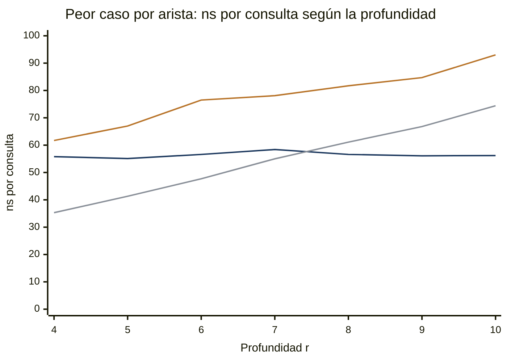

*Azul oscuro: Schrack (plano, 56.2 ns en r = 10). Naranja: Samet (crece hasta 93.0 ns). Gris: oráculo (crece hasta 74.4 ns).*

| Peor caso por cara | Peor caso por arista |
|---|---|
|  | 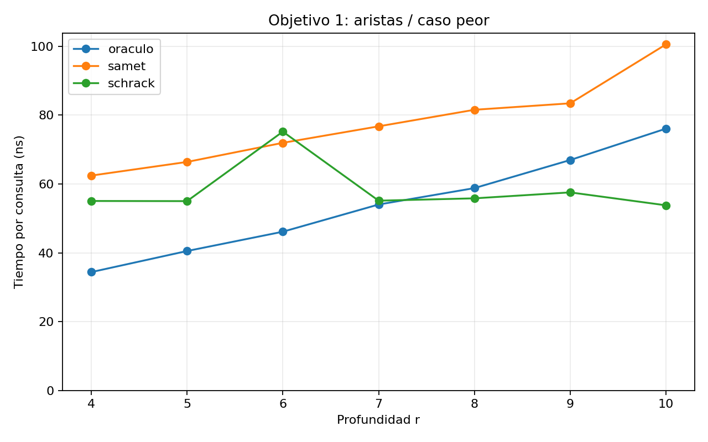 |

| Al azar por cara | Dígitos reflejados por Samet |
|---|---|
| 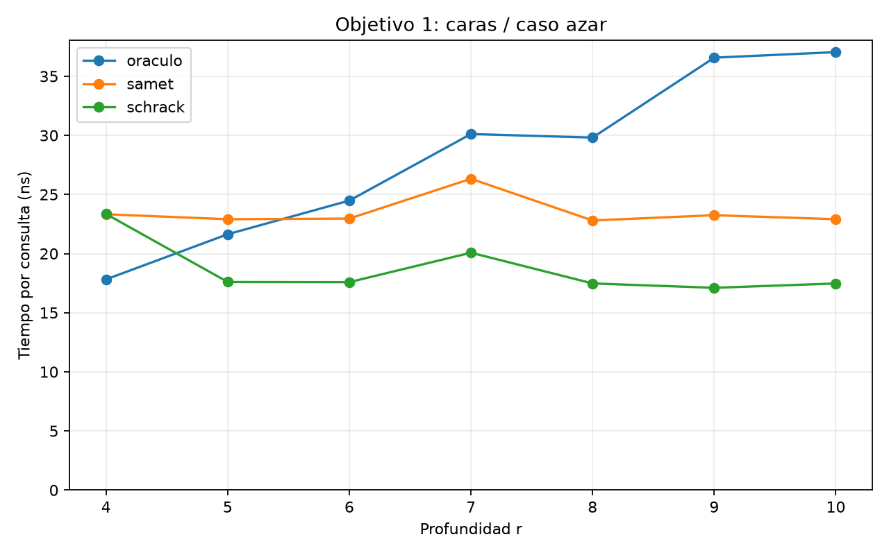 | 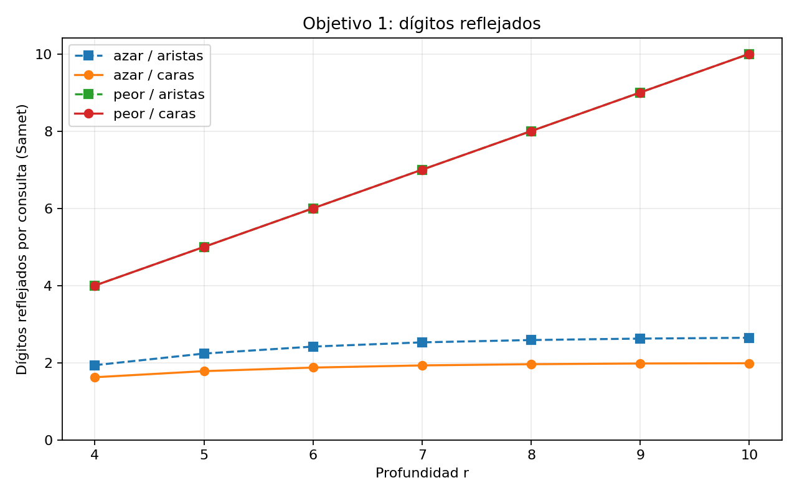 |

#### ¿Se observa el tiempo constante?

Sí. La tabla divide el tiempo en r = 10 entre el tiempo en r = 4; un cociente cercano a 1 indica que el costo no depende de la profundidad.

| Caso | Vecindad | Schrack | Samet | Oráculo |
|---|---|---|---|---|
| Peor caso | Caras | **1.01** | 1.32 | 2.02 |
| Peor caso | Aristas | **1.01** | 1.51 | 2.11 |
| Al azar | Caras | 1.08 | 1.09 | 2.15 |
| Al azar | Aristas | 0.99 | 1.07 | 1.98 |

- **Schrack es constante.** En el peor caso se mantiene en unos 44 ns por cara y 56 ns por arista de r = 4 a r = 10.
- **Samet crece en el peor caso**, porque refleja exactamente `r` dígitos: por arista pasa de 61.7 a 93.0 ns. Con r = 10, Schrack tarda el 60 % del tiempo de Samet por arista y el 75 % por cara.
- **Al azar, Samet también es casi constante**, porque refleja en promedio menos de 2 dígitos por cara y menos de 3 por arista, en línea con su costo esperado O(1).
- **El oráculo duplica su tiempo** entre r = 4 y r = 10, porque decodifica y vuelve a codificar recorriendo los bits.

### Objetivo 2: verificación de existencia

Búsqueda completa con r = 10, en nanosegundos por consulta:

| Superficie | Hojas | Método | Estructura | Dirección | Existencia | Total |
|---|---|---|---|---|---|---|
| Esfera | 16.2 M | Schrack | Binaria | 28.2 | 139.1 | 189.2 (8.2) |
| Esfera | 16.2 M | Schrack | Hash | 28.2 | 66.1 | 118.7 (4.6) |
| Esfera | 16.2 M | Samet | Binaria | 27.6 | 139.1 | 205.2 (11.5) |
| Esfera | 16.2 M | Oráculo | Binaria | 73.0 | 139.1 | 196.0 (4.9) |
| Toro | 32.5 M | Schrack | Binaria | 28.3 | 143.8 | 198.5 (7.1) |
| Toro | 32.5 M | Schrack | Hash | 28.3 | 63.2 | 109.6 (8.9) |
| Toro | 32.5 M | Samet | Binaria | 28.9 | 143.8 | 212.4 (7.8) |
| Toro | 32.5 M | Oráculo | Binaria | 73.4 | 143.8 | 205.9 (7.1) |

Los tres tiempos se miden por separado, así que el total no es exactamente la suma de las otras dos columnas.

| Consulta completa | Dirección frente a existencia |
|---|---|
| 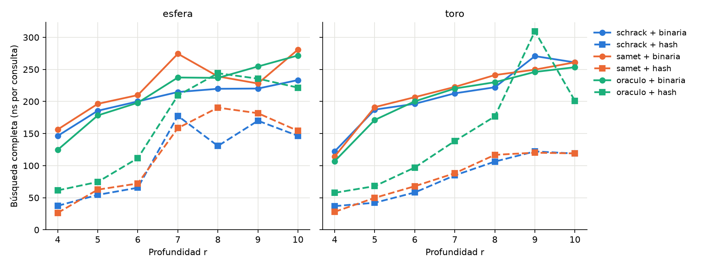 | 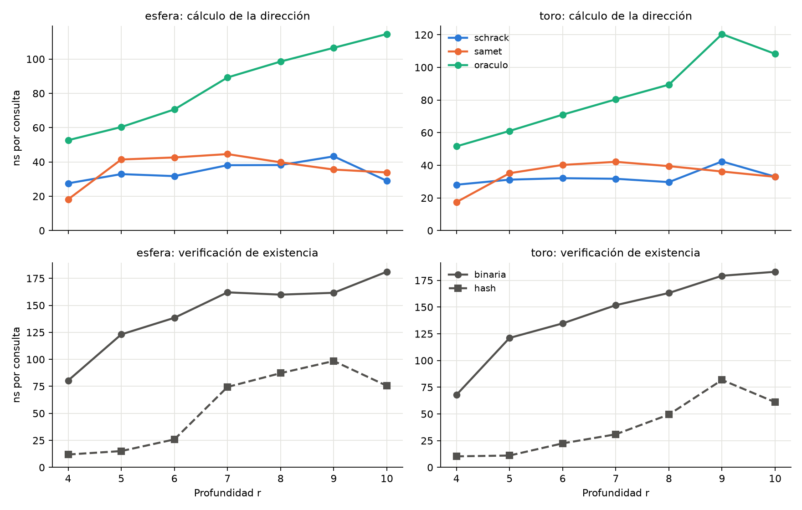 |

- **Verificar la existencia domina la consulta.** Con Schrack y búsqueda binaria es el 74 % del total en la esfera y el 72 % en el toro.
- **En las consultas de Marching Cubes, Schrack y Samet cuestan lo mismo** (unos 28 ns por dirección). Las vecinas consultadas comparten un ancestro cercano, así que Samet casi no recorre niveles.
- **La tabla hash reduce el total** de 189.2 a 118.7 ns en la esfera y de 198.5 a 109.6 ns en el toro.
- **Pero construirla es caro.** Con r = 10 tarda 3.01 s en la esfera y 5.34 s en el toro, frente a 0.92 s y 1.95 s del octree. Una pasada de Marching Cubes ahorra 0.46 s y 0.44 s, así que la tabla no se amortiza en una sola pasada.

### Objetivo 3: Marching Cubes con vértices compartidos

Vértices de la malla:

| Superficie | r | Celdas activas | 3 por triángulo | Compartidos en la celda | Compartidos entre celdas | Triángulos |
|---|---|---|---|---|---|---|
| Esfera | 7 | 37 856 | 227 112 | 151 416 | 37 854 | 75 704 |
| Esfera | 10 | 2 421 200 | 14 527 176 | 9 684 792 | 2 421 198 | 4 842 392 |
| Toro | 7 | 27 720 | 166 320 | 110 880 | 27 720 | 55 440 |
| Toro | 10 | 1 798 288 | 10 789 728 | 7 193 152 | 1 798 288 | 3 596 576 |

Tiempo de generación con r = 10, en segundos:

| Superficie | `mcSoup` | `mcPerCell` | `mcShared` con Schrack | `mcShared` con Samet | `mcShared` con oráculo |
|---|---|---|---|---|---|
| Esfera | 0.479 | 0.464 | 1.667 | 1.729 | 1.884 |
| Toro | 0.407 | 0.392 | 1.260 | 1.314 | 1.432 |

Fracción del tiempo de `mcShared` dedicada a buscar vecinos, con r = 10:

| Superficie | Método | Solo la dirección | Dirección y existencia |
|---|---|---|---|
| Esfera | Schrack | 10.7 % | 66.1 % |
| Esfera | Samet | 10.8 % | 68.0 % |
| Esfera | Oráculo | 25.4 % | 65.2 % |
| Toro | Schrack | 10.4 % | 63.3 % |
| Toro | Samet | 11.0 % | 65.4 % |
| Toro | Oráculo | 24.6 % | 62.5 % |

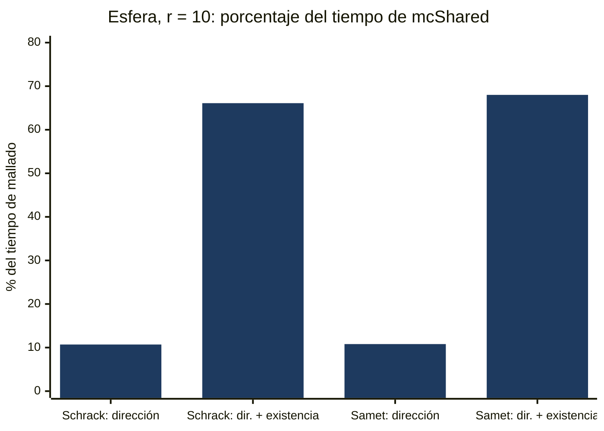

| Vértices por variante | Tiempo de generación | Peso de la búsqueda de vecinos |
|---|---|---|
|  | 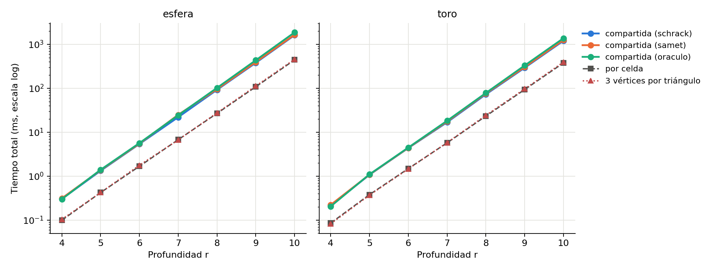 |  |

- **La malla compartida usa 6 veces menos vértices** que `mcSoup` y 4 veces menos que `mcPerCell`, con los mismos triángulos. La proporción es la misma en todas las profundidades.
- **Compartir vértices es más lento:** 3.48 veces el tiempo de `mcSoup` en la esfera y 3.10 en el toro.
- **Con Schrack, `mcShared` es un 3.6 % más rápido que con Samet** en la esfera y un 4.1 % en el toro.
- **Calcular la dirección es cerca del 11 % del mallado**, pero con la verificación de existencia sube a entre el 63 % y el 68 % con cualquier método. La búsqueda binaria es el cuello de botella.

### Objetivo 4: corrección

`make test` pasa completo. Schrack, Samet y el oráculo devuelven el mismo código con códigos aleatorios y en todas las consultas reales de Marching Cubes, y la malla compartida es idéntica con los tres métodos, cerrada y con los mismos triángulos que `mcSoup`.

`test_vecinos` reproduce los ejemplos numéricos del artículo de Schrack. Los ejemplos en 2D se reproducen porque las funciones de dilatación y suma están parametrizadas por la dimensión.

| Ejemplo del artículo | Valor esperado | Resultado |
|---|---|---|
| Figura 3: dilataciones en 3D de 0 a 7, con r = 3 | 0, 1, 8, 9, 64, 65, 72, 73 | Correcto |
| Dilatación en 3D de 5 | 65 | Correcto |
| Suma dilatada en 2D: 7 + 6, con r = 4 | Dilatación de 13 | Correcto |
| Dilatación en 2D de −5 | 69 (r = 3) y 325 (r = 4) | Correcto |
| Contracción en 2D de 69 | −5 | Correcto |
| Suma de location codes en 2D: 3013₄ ⊕ 2032₄ | 1301₄ | Correcto |
| Incrementos básicos en 2D, con r = 4 | 1, 3, 2, 87, 85, 255, 170, 171 | Correcto |

Como comprobación visual, `bin/mc` exporta las mallas con r = 7 a `results/esfera_r7.ply` y `results/toro_r7.ply`. Abiertas en MeshLab, ambas superficies son continuas y sin huecos, y sus conteos coinciden con `results/obj3.csv`.

| Esfera, r = 7: 37 854 vértices y 75 704 triángulos | Toro, r = 7: 27 720 vértices y 55 440 triángulos |
|---|---|
|  |  |

---

## Conclusiones

1. **El método de Schrack es correcto.** Coincide con Samet y con el oráculo en todas las pruebas, reproduce los ejemplos del artículo y genera la misma malla.
2. **El tiempo constante se observa.** El cálculo de la dirección con Schrack no cambia entre r = 4 y r = 10 (cociente 1.01), mientras que Samet crece un 32 % por cara y un 51 % por arista en el peor caso.
3. **La ventaja es pequeña con r ≤ 10.** Al azar y en las consultas de Marching Cubes, Samet también refleja pocos dígitos y cuesta casi lo mismo. En el peor caso por arista, Schrack ahorra unos 37 ns por consulta.
4. **En Marching Cubes domina la verificación de existencia**, no el cálculo de la dirección: con búsqueda binaria es entre el 72 % y el 74 % de la consulta y cerca de dos tercios del tiempo de la malla. Por eso la mejora de Schrack se reduce a un 4 % del tiempo total. La tabla hash reduce ese costo, pero su construcción no se amortiza en una sola pasada.
5. **Compartir vértices reduce 6 veces el tamaño de la malla**, a cambio de unas 3.5 veces más tiempo de generación.

---

## Limitaciones

- **Una sola máquina.** Los rangos intercuartílicos son pequeños frente a las diferencias que se discuten, pero las diferencias de pocos puntos porcentuales dependen de este equipo.
- **Solo vecinos de igual tamaño.** El criterio de subdivisión garantiza que las celdas que comparten una arista cortada sean todas de nivel `r`, así que no se presentan vecinos de otro tamaño.
- **La tabla hash no se probó dentro del mallado.** `mcShared` usa búsqueda binaria sobre las celdas activas; la tabla hash solo se midió en el objetivo 2.
- **Resolución máxima.** Con enteros de 64 bits, r ≤ 20, suficiente para las profundidades estudiadas.
- **Visualización externa.** Las mallas se exportan en formato `.ply` (solo para r = 7) y se inspeccionan con un visor como MeshLab.

---

## Referencias

1. I. Gargantini. *An effective way to represent quadtrees*. Communications of the ACM, 25(12):905–910, 1982.
2. I. Gargantini. *Linear octtrees for fast processing of three-dimensional objects*. Computer Graphics and Image Processing, 20(4):365–374, 1982.
3. W. E. Lorensen y H. E. Cline. *Marching cubes: a high resolution 3D surface construction algorithm*. SIGGRAPH '87, pp. 163–169, 1987.
4. H. Samet. *Neighbor finding techniques for images represented by quadtrees*. Computer Graphics and Image Processing, 18(1):37–57, 1982.
5. H. Samet. *Neighbor finding in images represented by octrees*. Computer Vision, Graphics, and Image Processing, 46(3):367–386, 1989.
6. G. Schrack. *Finding neighbors of equal size in linear quadtrees and octrees in constant time*. CVGIP: Image Understanding, 55(3):221–230, 1992.
